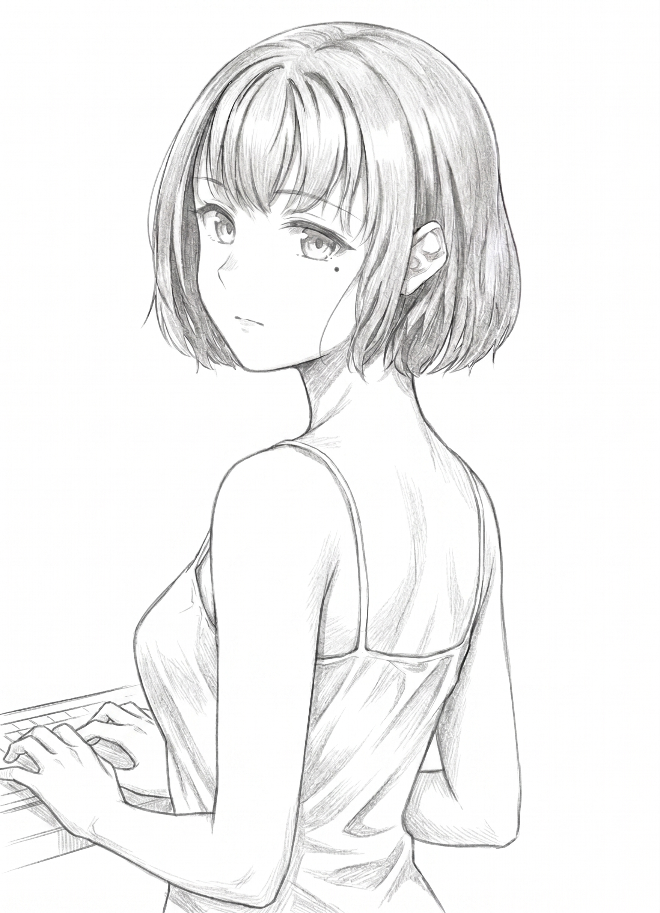

# 4章　砂上の箱庭 — Sandbox —

　翌朝、瑠璃見の町は、まるで何事もなかったかのように晴れ渡っていた。

　山の端から差し込む光は柔らかく、田んぼの水面には春の空が薄く映り込んでいる。通学路の坂を上る生徒達は、昨日の課題がどうだとか、配信ドラマの最終回がどうだとか、いつも通りの他愛ない話題で笑い合っていた。
　世界は、何も変わらない。
　昨日、旧校舎で綾と一緒に見たあの報告書も、一昨日の交差点で端末もなしに見えてしまった町の裏側も、すべては自分の頭の中だけで起きた悪い夢だったのではないか。

　そう思いたかった。
　けれど、鞄の底に隠したメモリーの小さな重みと、今朝玄関で祖母が持たせてくれたお守りの感触だけが、確かな現実の手触りを持って千花の肩にのしかかっていた。

　教室に入ると、いつものざわめきが千花を包み込んだ。
　スマートアイ越しに共有される朝の連絡事項、友人同士で飛ばし合う小さなスタンプ、机の上を滑っていく不可視のウィンドウ。千花はスマートアイを胸ポケットに収めたまま席に着き、紙の教科書を開いた。

「春風さん、今日スマートアイ忘れたの？」

　前の席の女子が、くるりと振り返る。

「ううん……ちょっと目が疲れてるだけ」
「ふーん。最近そういうの多くない？」

　悪気のない声だった。だからこそ、千花は曖昧に笑って誤魔化すしかなかった。
　視界の端で、黒板横の壁掛け時計が一秒ずつ針を進めていく。デジタルではない、アナログの針の動き。そこにはログも、認証も存在しない。ただ時間だけが静かに流れていることが、今の千花には少しだけ救いだった。

　四限目は、霧崎譲の技術の授業だった。

　黒板に並ぶ板書は、定規で引いたように整っている。センサーの仕組みと、自ら判断して動く自律機械についての講義。生徒達の間からは「意外と面白い」という囁きも漏れていた。
　けれど、霧崎の視線が時折こちらへ向けられるたびに、千花は胸の奥がすっと冷えていくのを感じた。

「春風さん」

　授業が終わり、荷物をまとめていたところで声を掛けられた。
　顔を上げると、霧崎がすぐ傍に立っていた。いつの間に近づいていたのか、足音にはまるで気づかなかった。

「先日の課題、提出を確認しました。無理をしていないのなら、それで結構です」
「……ありがとうございます」
「それと、念のためにお聞きしておきます。古いスマアイを使い続けていると、学校のレイヤー同期に不具合が出ることがあるんです。最近、通知が見えすぎる、あるいは……見えないはずのものが見える、ということはありませんか？」

　千花は、指先から血の気が引いていくのを感じた。

（見えないはずのものが……見える……）

　その言葉は、偶然と呼ぶにはあまりにも形が合いすぎていた。

「……ありません」
「そうですか」

　霧崎は微笑まなかった。ただ、手元の記録に何かを書き留めるように、一度だけ小さく頷いた。

「なら問題ありません。昨日も体調を崩されたようですし、優れない時は早めに保健室へ相談してください」

　教師としての、正しい言葉。心配の形をした、丁寧な言葉。
　それなのに千花には、その奥にあるはずの温度が、どうしても感じ取れなかった。

　逃げるように廊下へ出ると、反対側から綾が歩いてくるところだった。
　紅いスカートが、窓から差し込む春の光を受けて揺れている。千花の姿を見つけると、綾はいつものように軽く片手を上げた。

「お、いたいた。昼休み、ちょっと時間ある？」
「はい」
「じゃあ中庭ね。あ、コーラは今日は一本だけよ？　先生のお財布にも限界ってものがあるんだから」

　冗談めかした綾の声に、千花は少しだけ笑った。
　その自分の笑い方に、ふと、一年前の春が重なった。

　旧体育館の高窓から差し込む光は、いつも少しだけ金色を帯びていた。
　埃が舞い上がるたびに、その一粒一粒がきらきらと瞬く。まるで、空へ還る前の星屑のように。

　その光の中心に、ネオ・スターフライヤー号はあった。
　まだ骨組みだけの機体。翼は片方しか張られておらず、布と木材と古いカーボンパイプを無理やり組み合わせた、なんとも奇妙な代物だった。普通の人が見れば、粗大ごみの寄せ集めにしか見えなかっただろう。
　けれどカイは、このガラクタを『相棒』と呼んでいた。

「千花、そこのケーブル、ちょっと取って」

　機体の下に潜り込んだまま、カイが手だけをこちらへ伸ばしてくる。
　床には無数のケーブルが蛇のように散らかっていた。千花はとりあえず、一番太いものを手繰り寄せる。

「これ？」
「違う違う、それは昨日ショートさせたやつ。青いタグの方」

　言われてよく見れば、手にしたケーブルの端子には黒い煤がこびりついていた。

「ショートさせたやつを床に置かないでよ……」
「教訓として置いてるんだよ」
「……片付けて」

　はぁ、と千花は溜め息をつく。天才の言うことは、いつもよく分からない。せめて整理整頓くらいは心得てほしいものだ。
　そんなことを思いながらも、千花は青いタグのケーブルを探し出して手渡した。

　カイは口にネジをくわえたまま器用にそれを受け取ると、スマートアイの有線コネクタへと差し込む。
　現代の端末に、わざわざ開発者向けのアクセサリーを使って線を繋ぐ。その行為が、千花にはいつ見ても、何か古い儀式のように見えた。

「無線の方が速いんじゃないの？」
「速いよ。でも空を飛ぶものは、結局は線で考えた方がいい」
「……意味わかんない」
「地面とちゃんと繋がってるって確かめるんだよ」

　そう言って、カイは油まみれの顔で笑った。

　少し離れた場所では、綾が段ボールを机代わりにして書類仕事を片付けていた。
　派手な赤いブラウスに、首元で揺れる小さな翼のペンダント。時折二人の会話に呆れたように笑い、時折思い出したように教師らしく「火を出すなよ～」「穴開けるなよ～」「危険物はちゃんと申請しなさいよ～」と、冗談交じりの注意を飛ばしてくる。

　そのすべてが、千花は好きだった。
　退屈な町の中にある、退屈ではない場所。
　誰も自分を『かわいそう』と呼ばず、誰も自分の記憶を疑わない。ただ今日の失敗と、明日の修理だけが存在する場所。

「ねぇ、カイ」
「なに？」
「本当に……飛べると思ってるの？」

　カイは少しだけ考えるふりをした。実際には、考えるまでもないという顔だったけれど。

「飛べると思ってるから作ってるんじゃないよ」
「じゃあ、何？」
「飛ぶまで作るんだよ」

　あまりにも当然のように言うものだから、千花は返す言葉を失ってしまった。
　段ボールの机の向こうで、綾が吹き出す。

「青春だねぇ」
「からかわないでください……」
「からかってないわよ。いいじゃない、飛ぶまで作る。大人になるとね、飛べない理由の方を先に探しちゃうから」

　その時の綾の横顔を、千花は今でもよく覚えている。
　少しだけ寂しそうで、少しだけ、眩しそうだった。

―――――今思えば、あの場所は箱庭だったのかもしれない。

　誰かが作ったシミュレーション。現実に限りなく似せて作られた、砂の世界。
　けれど、あの時の風も、オイルの匂いも、綾の笑顔も、カイの声も、千花にとっては確かに現実だった。
　だからこそ、今の現実がどれほど正しい記録を並べ立てようと、千花の中ではそう簡単に勝てはしない。失われた時間は、失われたからこそ、まだ胸の奥で熱を持ち続けている。

　中庭のベンチは、桜の散った後の若葉の陰にすっぽりと包まれていた。
　綾は約束通り、缶コーラを一本だけ持ってきて千花に手渡した。自分の分は、購買の紙パックのコーヒーだ。

「週末の約束……忘れてないでしょうね？」

　ストローを咥えたまま、綾は少しだけ声を落とした。

「旧校舎のあのパソコンで、もう一度ちゃんと一緒に確かめよう」
「……はい」

　綾は言葉を探すように、指先で紙パックを軽く押した。

「あれは、正直まだわからない。でもね、前から言ってるけど、千花ちゃんが嘘をついてるとは、やっぱり思えないかな」

　その一言だけで、千花は胸が詰まった。

「……私、怖いです」
「うん」
「メモリーに書いてあったことも怖い……でも、それよりも、あの交差点で見えたものが怖いんです。スマートアイもなしに、町の情報が頭の中に流れ込んできて……見ようと思えば、もっと奥まで見えてしまいそうで……」

　言葉にした途端、漠然としていた恐怖がはっきりとした形を持った。
　綾は、笑わなかった。大げさだとも、疲れているだけだとも言わなかった。

「じゃあ、今は『見ない練習』をしよう」
「見ない……練習？」
「そう。目を閉じる。追わない。ゆっくり息をする。単純だけどね、こういう時は、原始的で単純なことしか効かないのよ」

　そう言って、綾は軽く笑った。
　その笑い方が、今の千花を日常へと繋ぎ止めてくれる、たった一本の細い糸だった。

　瑠璃見の谷を越えた先、廃線跡にひっそりと置かれた偽装コンテナの中は、昼間でも薄暗かった。

　清水暁美は、三枚並んだモニタを走る波形をじっと見据えていた。
　町の広域ネットワーク、学校のレイヤー、そして個人端末群。その中に、昨夜から一本だけ、妙な枝が生えている。
　仮眠とシャワーの合間にも乾かす暇のなかったショートボブの黒髪にタオルを掛けたまま、清水は巡らせた思考をキーへと叩き込んでいた。

「永洞綾の端末……昨夜開いた業務連絡の添付ファイルと同じタイミングで、ログ断片に類似する走査痕。神楽、外部への送信は？」

『現時点では限定的です。通常のクラウド同期に偽装された微弱なビーコンを確認。発信源はAFX-012-VFZ23』

　返ってきた声は、少女のようにも、合成音声のようにも聞こえた。
　世界にも数えるほどしか存在しない超高度AIの一基《神楽》。清水はやり取りのたびに、その相手が機械なのか、それとも優秀すぎる同僚なのか、わからなくなる。

「ビーコンの宛先は？」
『三段リレー。最終到達先は、瑠璃見高校の技術準備室内の端末を経由し、さらに外部へ転送待機中です』

　清水は小さく息を吐いた。

「校内、ですか……」

　その時、スマートアイが震え、立山美弓からの通信が開いた。
　きっちりと整えられた黒髪に、落ち着いた瞳。背景には仮想の青空が広がり、その声はどこまでも柔らかく整っている。

『サウナにでもいるのかしら？　そんな恰好で……まあいいわ。それより、やはり接触してきたわね』
「ええ、乾かす暇も与えてくれない上司がいますので。現時点で対象本人への危害はありませんが、永洞綾の端末が踏み台にされかけています」
『永洞……国語の先生ね。一般人よ。巻き込ませないで』
「了解しました。神田さんは？」
『応答あり。いつも通り、対象の周辺で待機しているわ』
「……またですか」
『対象が自分の足で日常から一歩踏み出す前に、こちらが無理に奪えば、あの子は折れる。それが神田の判断よ』

　清水は、モニタの片隅に映る瑠璃見高校の校舎に眼をやった。
　昼休みの中庭。紅いスカートの教師と、肩まで髪を伸ばした少女が、並んでベンチに座っている。

「その日常……もう、ひび割れていますよ」
『そうね。だからこそ、せめて今夜までは持たせるのよ。木村が合流するまで監視を継続して。いいわね？』

　通信が切れるのと入れ替わるように、神楽のモニターグラフィックが薄青く脈打った。

『警告。十三課系統の暗号通信量が急増しています』
「場所は？」
『学校の坂下および春風千花の自宅周辺。加えて、永洞綾の帰宅経路です』

　清水の手が、自然と戦闘用白衣の腰に吊るしたホルスターへと伸びた。

「二面作戦ですか……」

　狐が狙う獲物は、一匹だけとは限らない。
　そこへキャッチが入る。木村佳織だった。音声のみで、背後には車のエンジン音が低く響いている。

『暁美さん、そちらの状況は？』
「永洞綾の端末が狙われています。春風千花の自宅側にも敵の動き。佳織さんは今どこですか？」
『学校へ向かっています。到着まで、あと二十分』
「少しきわどいですね。…では、学校側の永洞先生の保護は佳織さんに任せます。私はこのまま車両を出して、神田さんの合流と春風千花の回収へ回ります」
『了解しました。こちらは必ず間に合わせます。こちらの足がオーバーヒートするかもしれませんが……何としてでも』
「無茶はしないでくださいよ。一人じゃ対処しきれないでしょう」
『分かっています。でも、私にも神楽のバックアップがありますから』
「……結局は私たちは神楽頼みですか…」
『はい。それが私たちの仕事ですから…では合流地点で』

　通信を切り、清水は医療バッグとキーを掴んでコンテナの扉を蹴り開けた。

　放課後、千花はしばらく図書室で時間を潰していた。

　鞄の底には、あのメモリーがある。
　昼休みの別れ際、綾には「今日は早く帰りなさい」と言われていた。わかっている。けれど、まっすぐ家に帰る気にもなれず、気がつけばページをめくる手だけが止まっていた。
　祖母の顔が浮かぶ。今朝、玄関先で手渡してくれた小さなお守り。昨夜の、優しい手のぬくもり。

（……帰ろう）

　千花は本を閉じ、鞄を肩に掛けて図書室を後にした。

　坂を下る。いつもの通学路。夕焼けが、町を赤く染め上げていた。
　もうすぐ家だ。祖母が待っている。今夜は約束通りカレーだろうか、それともまた魚を煮てくれているのだろうか。
　家に帰れば祖母がいる。その事実だけで、千花は少しだけ呼吸が楽になるのを感じていた。

　庭の駐車スペースに自転車を止める。
　いつもと変わらない、古い平屋の家。だが、玄関の明かりはまだ点いていなかった。

（おばあちゃん、まだ台所かな……）

　自転車を降り、玄関の引き戸に手を掛けた――その時だった。

　ガシャン、と。
　家の中で、何かが倒れる音がした。

「おばあちゃん……？」

　声を掛けたが、返事はない。
　代わりに聞こえてきたのは、低い、見知らぬ男の声だった。

「ターゲットを確認」

　千花の心臓が、どくんと大きく跳ねた。
　誰かが、家の中にいる。この長閑な田舎町にはあまりにも不釣り合いな、冷たい気配。

（逃げなきゃ……でも、おばあちゃんは！？）

　祖母は中にいる。たった一人で。
　千花は震える手で、鍵のかかっていない玄関の戸を引き開けた。

「ただいま……」

　次の瞬間、居間の方から祖母の悲鳴が飛んできた。

「千花！　来ちゃダメ！　逃げなさい！」

　その声に、千花は我を忘れて居間へと駆け込んだ。

　そこには――黒いスーツに身を包んだ男女が、三人。
　サングラスのように透過率を落としたスマートアイで、その表情は窺えない。そして、床に無理やり座り込まされた祖母の姿があった。祖母の頬には、殴られたのか赤い痣が浮かんでいた。

「おばあちゃん！」

　千花が叫ぶと、黒スーツの一人がゆっくりとこちらを向いた。感情のない、機械のような眼だった。

「春風千花」

　千花は祖母の方へ駆け寄ろうとした。だが、横から伸びてきた別の男の手が、千花の腕を鉄の万力のように掴み上げた。

「離して！　おばあちゃんに何するの！」
「動くな。我々の要求に従ってもらおう」

　冷たい声。ただ命令するだけの、何の感情もない口調。ロボットのように無駄な表情金を一切使わない不気味の谷の人型。
　千花が必死にもがいた、その時――祖母が立ち上がった。

「千花に触るなっ！」

　祖母が、千花を掴む黒スーツの男へと必死に掴みかかる。
　七十を過ぎた老婆の、渾身の抵抗だった。だが男は眉一つ動かさず、祖母を容赦なく突き飛ばした。

　小さな身体が、壁に叩きつけられる。
　祖母の肩から、寒気のするような嫌な音が響いた。

「やめて！　おばあちゃん！」

　千花の叫びにも、男達は動じなかった。
　代わりに、一人が倒れた祖母へとゆっくり腕を向ける。その手に握られていたのは、消音器のついた鈍い黒色の銃器。

「目撃者。処理を推奨」

　その言葉の意味を、千花は一瞬で理解してしまった。

「やめて！　やめてっ！　お願い！　おばあちゃんは関係ないっ！」

　千花は泣き叫んだ。腕を掴まれたまま必死に暴れたが、男の腕は微動だにしない。
　壁際に崩れ落ちた祖母が、ゆっくりと千花を見た。
　その眼は、優しかった。昨夜、千花の頭を撫でてくれた時と同じ、いつもの優しい眼だった。

「千花……大丈夫……おばあちゃんは……千花が……無事なら……」

　バシュ……。

　乾いた、あまりにも軽い音。クラッカーを鳴らすそれに似たそれは、刹那を永遠にも近い時間に引き延ばした。
　火花が周囲を照らし、祖母の身体が、糸が切れたように崩れ落ちる。少し遅れて鼻をつくイオンの香り。フローリングに着弾しかすかに地面を揺らした。　すべての動作が目に焼き付くのに体は全く動かない。

「おばあちゃんっ！！」

　千花の絶叫が、居間に響き渡った。
　だが、祖母は動かない。畳の上に倒れたまま、ぴくりとも動かない。
　その胸元に、赤い染みがじわじわと広がっていく。

「おばあちゃん！　おばあちゃん！」

　声が枯れるまで、千花は叫び続けた。
　これは悪い夢だ。目を覚ませば、祖母が笑っている。「千花、朝ごはんできとるよ」と、いつものように声を掛けてくれるはずだ。
　だが、何度瞬きをしても、現実は何一つ変わらなかった。

　腕を掴んでいた手が、ふっと離れる。
　千花はそのまま床に崩れ落ち、這うようにして祖母の傍へと近づいた。
　冷たくなり始めた手を握る。ついさっきまで温かかったはずの、千花の頭を撫でてくれた手。

「起きて……お願い……起きてよ……」

　涙が止まらない。視界が滲む。胸が押し潰されそうに苦しい。

（私の……せいだ……）

　自分が、あんな得体の知れないことに関わったから。
　自分が、ここに帰ってきたから。
　祖母は、千花を守って死んだ。

「対象の心理状態、不安定。…記憶媒体および対象の回収を優先する。死体でも構わないとのことだ。」

　男の声が頭上で響く。
　その時――千花の視界が、白く弾けた。

《W■RN■NG／／／》
《L1FE S■GN: TERМ■NAT■D》
《HARUK■ZE TSUB■KI: DEC■ASED》
《H△RU█AZE TS□BA█I: D3C■AS■■》

　どこかの情報が、勝手に脳内へと流れ込んでくる。同じ文言なのに、文字が欠け、重なり、別の符号にすり替わる。
　祖母の生体反応がゼロになったことを告げる無機質な文字列。心拍停止。体温低下。死亡確認。……読めるはずなのに、途中でノイズに食われる。

（やめて……！）

　見たくない。なのに情報は容赦なく流れ込み続け、祖母の死を冷たい数字とデータへと書き換えていく。
　
「いやだ……いやだ……いやだ……っ！」

　千花は頭を抱え崩れ落ちた。
　その瞬間、首筋の傷跡が、焼けるような熱を持った。
　そこから炎のような奔流が、一気に脳の奥へと駆け上がってくる。

《EM□TI□NAL □VERL□AD》
《SAF■TY L■M■T EXC■■DED／／》
《C□RE ■NTERFACE: UNST■BL■》
《C■RE INT■RF■■E: ▓▓▓▓▓▓▓》

　千花の意思とは関係なく、頭蓋の奥で『何か』が枷を外して動き始めていた。

（やめて……やめて……っ）

　止められない。濁り、色を失ったありとあらゆる感情が、制御できない奔流となって溢れ出していく。
　次の瞬間、千花の視界いっぱいに、町全体の姿が広がった。

　瑠璃見の町、学校、商店街、信号機、街灯、防犯カメラ、自動配送車、スマートホームの制御網――そのすべてが、細い光の線で自分の脳へと繋がって見える。

《C□NNECT■ON ESTABL■SHED》
《RUR■MI W■DE NETW■RK／／／》
《ACC■SS■NG ALL SYST■MS》
《ACC■■■ING ALL SYST▓▓▓》
《RURIMI W■DE N■TW■RK — OP■N》

　手を伸ばしたくなどないのに、頭の中の何かが勝手に命令を送り出していく。
　交差点の信号が、一斉に赤に変わる。
　街灯が、不規則に明滅を始める。
　防犯カメラが、すべて同じ方向を向いて停止する。
　自動配送車が制御を失い、スマートホームの扉が勝手にロックされ、ダム湖の底に沈むサーバー施設が異常負荷の警報を吐き出した。

　町全体が、千花の悲鳴に共鳴するように混乱の渦へと呑み込まれていく。そのすべてのイメージを知覚した。
幻覚ではない

「やめて……やめてっ！」

　祖母を殺された。祖母を守れなかった。
　町が、頭の中にいる。

　そして――。

　プシュッ……。

　また、あの乾いた空気音が鳴った。
　千花の右肩に、鋭い衝撃とともに細い針が突き刺さる。

　熱い。焼けるように痛い。

「対象の暴走を確認。接続核の強制起動を認める……制御不能。非致死弾で制圧する」

　黒いスーツの男の声が、水底のように遠く聞こえた。
　千花は膝から崩れ落ち、その世界は音を立てて暗闇へと沈んでいった。
